# Modélisation des Données & Architecture Système

## 1. Diagramme Entité-Relation (Mermaid)

```mermaid
erDiagram
    LEADS ||--o| WEDDINGS : "converti en"
    WEDDINGS ||--o{ PHOTOS : "possede"
    WEDDINGS ||--o{ WEDDING_TABLES : "definit"
    WEDDINGS ||--o{ GUESTS : "invite"
    WEDDING_TABLES ||--o{ GUESTS : "accueille"
    WEDDINGS ||--o{ CONTRIBUTIONS : "recoit"

    LEADS {
        int id PK
        string bride
        string groom
        string phone
        string email
        string city
        string event_date
        string event_type
        string plan
        string partner
        string notes
        int wedding_id FK
        string status
        string created_at
    }

    WEDDINGS {
        int id PK
        string slug UK "Identifiant unique dans l'URL (/i/slug)"
        string status "draft | published | archived"
        string plan "essentiel | prestige | royal"
        int price
        int paid
        string partner
        int partner_commission
        string event_type "mariage | dot | mariage_dot"
        string bride
        string groom
        string headline
        string story
        string hashtag
        string event_date "Format ISO (UTC+1 Douala)"
        string venue_name
        string venue_address
        string city
        string maps_query
        string program "JSON Array"
        string dress_code
        string theme "royal | ndop | kaba | ivoire | emeraude"
        string music_url
        string cover_photo
        string rsvp_deadline
        string couple_phone
        string couple_email
        int cagnotte_enabled
        int cagnotte_goal
        string cagnotte_text
        string momo_number
        string momo_name
        string om_number
        string om_name
        int payout_done
        int max_guests "Quota maximum de places"
        int strict_rsvp "1 = liste fermee stricte"
        string access_key "Clé secrète d'administration couple"
        int lead_id FK
        int views
        string created_at
        string updated_at
    }

    WEDDING_TABLES {
        int id PK
        int wedding_id FK
        string name "Nom choisi par les maries"
        int capacity "Nombre de chaises"
        string category "Cercle d'intimite"
        int position
        string created_at
    }

    PHOTOS {
        int id PK
        int wedding_id FK
        string filename
        int position
        string created_at
    }

    GUESTS {
        int id PK
        int wedding_id FK
        string name
        string phone
        int seats "Nombre de places allouees"
        string category "Cercle d'intimite"
        int table_id FK "Table attribuee"
        string table_name "Nom de la table"
        string seat_numbers "Numeros de sieges (ex: 1-2)"
        string token UK "Token pour URL personnalisee et QR"
        string status "pending | yes | no"
        int attending_count "Nombre reel de personnes confirmees"
        string message "Livre d'or"
        string source "list | public"
        string invited_at
        string responded_at
        string checked_in_at "Horodatage de l'entree jour J"
        string created_at
    }

    CONTRIBUTIONS {
        int id PK
        int wedding_id FK
        string name
        string phone
        int amount
        string message
        string reference UK
        string provider_ref
        string status "pending | complete | failed"
        string provider "notchpay | demo"
        string created_at
        string paid_at
    }
```

---

## 2. Contrats d'API & Flux de Données

### A. Tunnel Invité (Public)
* `GET /i/:slug` : Affiche l'invitation. Si `?g=:token` est présent, pré-remplit les coordonnées de l'invité.
* `POST /i/:slug/rsvp` : Enregistrement de la réponse (Présence / Absence / Nombre de convives / Vœux).
* `GET /i/:slug/pass/:token` : Pass d'entrée sécurisé affichant le QR code d'accueil.
* `POST /i/:slug/cagnotte` : Initialisation du don via Notch Pay (ou fallback démo).
* `POST /webhooks/notchpay` : Réception asynchrone des confirmations de paiement (sécurisé par signature HMAC-SHA256).

### B. Espace Mariés (Authentification par Token / Cookie signé)
* `GET /espace/:slug` : Dashboard mariés (RSVP, cagnotte, relances).
* `POST /espace/:slug/invites` : Ajout d'invités (unitaire ou import textuel).
* `GET /espace/:slug/export.csv` : Export complet compatible Excel / LibreOffice.
* `POST /espace/:slug/checkin/:token` : Validation de l'entrée d'un invité au scan du QR code.

### C. Back-Office Admin (Protection par session admin)
* `GET /admin` : Dashboard financier, suivi des leads et des commissions partenaires.
* `POST /admin/mariages/:id` : Éditeur complet du faire-part.
* `POST /admin/mariages/:id/action` : Publication, encaissement, archivage.
